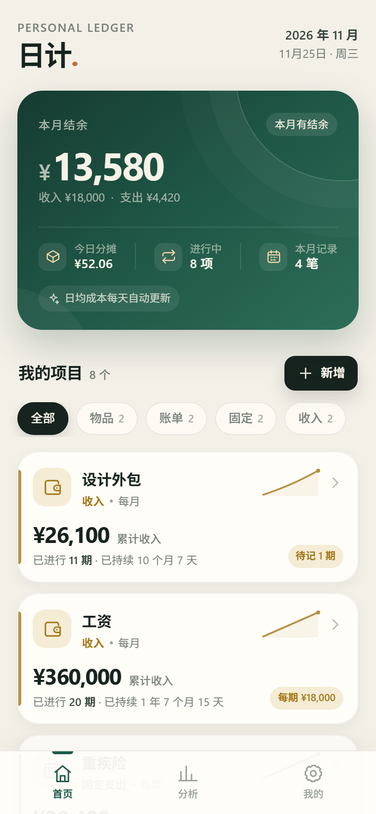
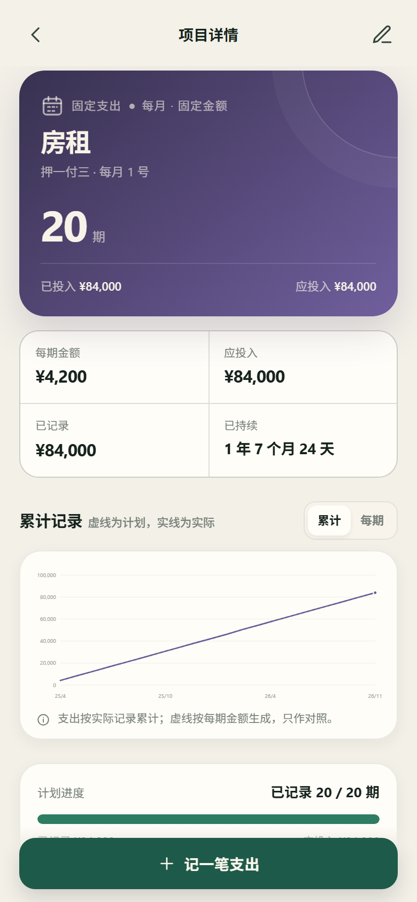
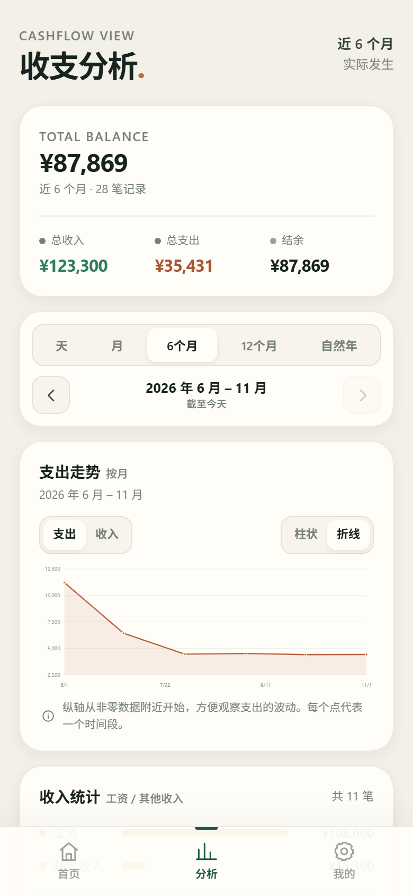
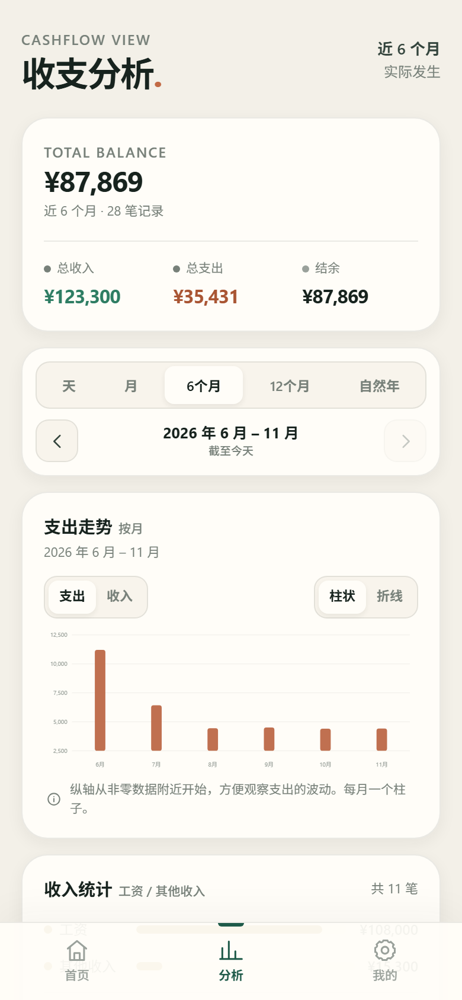
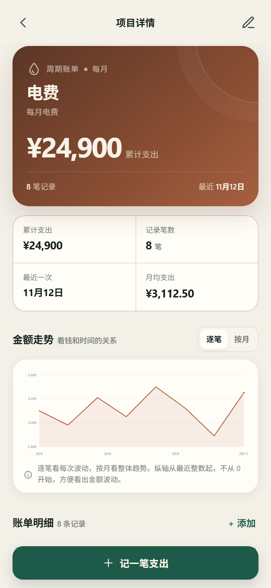
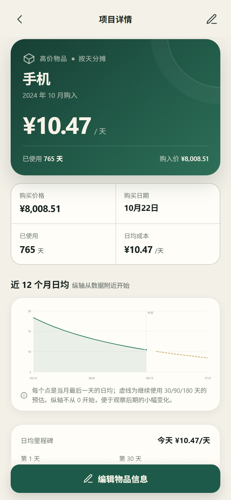

# 日计 · 个人收支台账

一个完全离线的安卓 App，用来记录高价物品、周期账单、固定支出和收入。数据只保存在手机本地。

开源地址：[github.com/bao0541/riji](https://github.com/bao0541/riji) · [Releases](https://github.com/bao0541/riji/releases)






周期账单的纵轴从数据附近开始，3000 元档的几十元波动也能看出来：



高价物品用近 12 个月曲线看后期变化，用里程碑看早期如何摊薄：



## 功能

- **高价物品**：填写购买价和购买日期，按“购买价 ÷ 已使用天数”实时计算日均成本；图表展示近 12 个月的日均变化，并用“第 1 / 30 / 90 / 180 / 365 天”里程碑展示早期高价如何被摊薄，不再把 8000 元和 10 元放在同一根纵轴上。
- **周期账单**：电费、水费、天然气等放在同一个项目里，逐笔记录日期、金额和备注；首页显示最近一笔金额和日均，详情支持逐笔走势图和按月汇总柱状图。图表纵轴从数据附近的整数开始，3000 元档的几十元波动也能看清。
- **固定支出**：房租、保险等设置每期金额、开始日期和周期；自动计算已进行期数、已持续时间和应投入金额，支持一键补记到期期数，也可逐笔修改。
- **收入**：工资或其他收入只建一个类目，不设固定金额和固定周期；每次到账后按实际日期和金额记一笔，金额可以每月不同。首页展示累计收入、记录笔数、已持续时间和最近一笔，详情有按月/累计收入走势和完整明细。
- **首页**：本月收入 / 支出 / 结余、今日物品分摊、全部项目列表；每张卡片直接显示分摊或统计，点进去看明细和图表。
- **分析**：按天 / 月 / 6 个月 / 12 个月 / 自然年查看收支，支持年份切换；包含可切换的收入 / 支出走势、收入统计、支出结构（累计 / 本期）和支出项目 TOP 5。
- **数据**：SQLite 本地数据库主存储（旧版 localStorage 首次打开自动迁移）、JSON 导出 / 导入备份、示例数据、清空数据。无账号、无网络请求、无广告。

## 安装到安卓手机

1. 从 [GitHub Releases](https://github.com/bao0541/riji/releases) 下载最新 APK（或使用本地构建产生的 `dist/riji-v1.6.0.apk`），传到手机（数据线、微信文件传输、网盘均可）。
2. 在手机上点开 APK。
3. 如果系统提示“不允许安装未知来源应用”，按提示允许当前文件管理器 / 浏览器安装。
4. 如出现 Play Protect 提示，选择“仍要安装”。这是个人签名包，不在应用商店上架。
5. 安装后桌面会出现「日计」图标。

最低支持 Android 6.0（API 23），建议 Android 10 及以上。

> 这是个人使用的 debug 签名 APK，不是上架版本。后续升级请使用同一份 `debug.keystore` 重新签名，并保持包名 `com.riji.app` 不变，才能覆盖安装并保留数据。
>
> **升级时不要先卸载旧版。** 直接把新 APK 覆盖安装（系统会显示“更新”），本地记录会保留。1.6.0 已把 versionCode 提升到 7，可以正常覆盖 1.5.0 / 1.4.0 / 1.3.0 / 1.2.0 / 1.1.0 / 1.0.0。

## 1.6.0 调整

- 首页项目支持**长按拖动排序**，排序结果保存在本机；切到分类筛选时暂不拖动。
- 日期选择改成自定义的年 / 月 / 日选择器，可以直接跳到 2024、2025 等年份，适合补录较早记录。
- 所有备注字段统一使用多行 `textarea`，包括每一笔收入 / 支出记录的备注。

## 1.5.0 调整

- 收入改成**类目 + 逐笔记录**：不再设置固定金额、开始日期和固定周期。
- 工资每月到账金额不同也没问题，每次到账按实际日期、实际金额记一笔。
- 首页收入卡片展示累计收入、记录笔数、已持续时间和最近一笔金额。
- 收入详情改为按实际到账的明细和按月 / 累计走势图，不再推算“应收”或“每期金额”。
- 旧版收入项目中已经录入的实际明细会保留；旧的固定金额 / 周期字段会被忽略，不再自动生成收入。

## 1.4.0 调整

- 分析页走势图同时支持 **折线图 / 柱状图**，右上角可直接切换。
- 两种图表都改成从非零数据附近的整数开始，3000 元档的几十元波动也能看清。
- 没有记录的月份不再把纵轴拉回 0；缺失的点 / 柱子会跳过，并在图下说明。
- 默认使用折线图看趋势，柱状图仍可一键切换。

## 1.3.0 调整

- 账本主存储从 WebView localStorage 迁移到 **SQLite 本地数据库**（`riji.db`）。
- 首次打开 1.3.0 会自动把旧版 localStorage 里的记录迁移到 SQLite，并在界面提示；不会丢记录。
- 迁移只在 SQLite 为空时执行一次；如果 SQLite 已经有数据，会直接使用数据库，不会再把缓存合并进来，因此不会产生重复记录。
- 迁移写入失败时，旧缓存继续保留，下次启动会自动重试；不需要用户重新录入。
- SQLite 为主存储，localStorage 保留一份同步缓存作为兜底；两者都只在 App 私有目录。
- 覆盖安装不会清除数据库；卸载 App 或在系统设置里“清除数据”才会删除。
- 设置页和关于信息改为显示 SQLite 存储。

## 1.2.0 调整

- 分析页增加「天 / 月 / 6个月 / 12个月 / 自然年」切换，并支持前后翻页和自然年选择。
- 汇总卡、走势图、收入统计和项目排行都跟随所选时间段统计。
- 收支汇总改成三列自适应布局，金额较大时不会挤在一起；超过一百万才用“万”缩写。
- 分析走势图改成单系列可切换「支出 / 收入」，纵轴从非零数据附近开始，3000 元档的波动更直观。
- 新增「收入统计」：工资 / 其他收入分类、金额占比和收入项目明细。
- 「支出结构」新增「累计 / 本期」切换；默认累计，包含所有物品购买价、账单和固定支出的全部记录合计。
- 天视图新增当日记录明细。

## 1.1.0 调整

- 周期账单首页改为“最近一笔金额 + 累计日期 + 日均”，不再用累计总额做卡片主数字。
- 周期账单的折线图和柱状图改为动态纵轴，从数据附近的整数开始，金额波动更明显。
- 高价物品详情改为“近 12 个月日均曲线 + 日均里程碑”，并保留继续使用后的预估值。
- versionCode 提升到 2，包名和签名不变；直接覆盖安装会保留已有记录，不要卸载旧版。

## 使用建议

- 第一次打开可以先点“先看示例”，了解四类项目的呈现方式；示例可以逐个删除。
- 固定支出创建后，如果之前已经交过很多期，点详情里的“补记到期 N 期”，会按计划日期生成记录，再逐笔改金额或备注。
- 收入不按固定金额推算：每个月实际到账多少，就点“记一笔收入”填多少，日期也可以改。
- 物品的日均每天打开 App 时会按最新天数重新计算；跨天后重新打开即可看到新数字。
- 换手机前，到「我的 → 导出备份」复制 JSON；新手机安装后「导入备份」粘贴恢复。

## 数据与隐私

- 主数据保存在 App 私有目录的 SQLite 数据库 `riji.db` 中，不联网、不上传。
- 同时保留一份 WebView localStorage 缓存作为兜底；SQLite 写入失败时仍可暂存到缓存。
- App 不需要账号、位置、通讯录、相册等权限。
- 覆盖安装保留数据库；卸载 App、清除 App 数据会删除本地记录，请定期导出备份。
- 备份 JSON 中包含全部项目名称、金额和备注，分享时注意隐私。

### 为什么用 SQLite

WebView localStorage 默认不会像 Cookie 那样自动过期，但它依赖 WebView 的存储实现。清理 WebView 数据、系统存储清理、App 数据损坏或刷机恢复时，可能整块丢失。SQLite 文件更明确、更稳定，也方便以后做拆表和查询。1.3.0 首次打开会自动迁移旧 localStorage 数据。

## 从源码构建

需要 JDK 17、Android SDK Build-Tools 34、Platform 34。

```powershell
git clone https://github.com/bao0541/riji.git
cd riji
.\build.ps1 -SdkRoot "C:\path\to\android-sdk" -JavaHome "C:\path\to\jdk-17"
```

构建产物在 `dist/riji-v1.6.0.apk`。

首次构建会在仓库根目录生成本地签名密钥 `debug.keystore`，它已被 `.gitignore` 排除，不会提交到 GitHub。发布到 GitHub Releases 的 APK 使用同一份密钥签名，方便覆盖升级。

项目结构：

```
.
  app/src/main/
    AndroidManifest.xml
    java/com/riji/app/MainActivity.java   # WebView 容器、本地资源拦截、剪贴板桥
    java/com/riji/app/StorageDb.java      # SQLite 主存储
    assets/index.html                     # App 界面
    assets/styles.css
    assets/app.js                         # 数据、计算、图表、交互
    res/                                  # 图标、主题、字符串
  docs/                                   # README 截图
  build.ps1
  .gitignore                              # 排除 build/dist/debug.keystore
  LICENSE
```

## License

[MIT](LICENSE) © 2026 Tongbo

如果这个项目对你有帮助，欢迎在 [GitHub](https://github.com/bao0541/riji) 点一个 Star。

## 计算口径

- 物品日均 = 购买价 ÷ 已使用天数（含购买当天）。
- 账单月均 = 累计金额 ÷ 有记录的月份数。
- 固定支出：
  - 应进行期数 = 从开始日期到今天的周期数（含开始当天）。
  - 应投入 = 应进行期数 × 每期金额。
  - 已记录 = 实际添加的明细金额之和。
  - 补记只补“应进行期数 - 已有记录数”的期数，按计划到期日生成。
- 收入：
  - 不设固定金额、开始日期或周期。
  - 累计收入 = 所有实际收入明细之和。
  - 月均收入 = 累计收入 ÷ 有记录的月份数。
- 首页本月收支只统计实际记录；物品在购买当月一次性计入支出。
